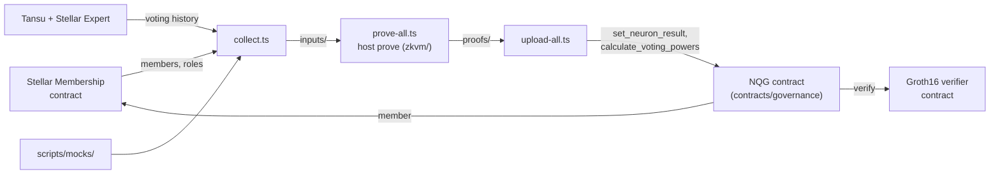

# Neuron scores proven with RISC Zero and stored on Stellar

This repository computes neuron scores for Stellar Community Fund members,
proves with [RISC Zero](https://risczero.com/) that the scores were computed
correctly, and stores them on Stellar together with the proof, in the Neural
Quorum Governance (NQG) contract that turns them into voting powers.

Each neuron calculates one part of a member's score, such as reputation or
voting participation. NQG combines these scores into voting power.

The repository has these parts:

| Part | Path | What it does |
| --- | --- | --- |
| Prover | [`zkvm/`](zkvm) | Runs a neuron inside the RISC Zero zkVM and produces a Groth16 proof plus one output JSON file |
| Flow scripts | [`scripts/`](scripts) | `collect.ts` reads all data needed by the neurons and writes each neuron's input, `prove-all.ts` proves all neurons, `upload-all.ts` sends the proofs and calculates the voting powers |
| Contract | [`contracts/governance/`](contracts/governance) | The NQG contract. Checks the proof with the Groth16 verifier, stores the scores per layer, neuron and round, and computes the voting powers |

NQG uses two other contracts: Stellar Membership to check that members are
active, and the [Groth16 verifier](https://github.com/NethermindEth/stellar-risc0-verifier)
to check proofs. The setup below uses an existing Membership contract on
testnet and deploys the verifier.

See the [contract README](contracts/governance/README.md) for its interface,
error codes and membership integration.


## Contents

- [How it works](#how-it-works)
- [Requirements](#requirements)
- [Run the full flow (testnet)](#run-the-full-flow)
  - [1. Build the prover and install dependencies](#1-build-the-prover-and-install-dependencies)
  - [2. Create the admin identity](#2-create-the-admin-identity)
  - [3. Set up the contracts](#3-set-up-the-contracts)
  - [4. Configure the scripts](#4-configure-the-scripts)
  - [5. Collect inputs](#5-collect-inputs)
  - [6. Prove the neurons](#6-prove-the-neurons)
  - [7. Upload the proofs and calculate voting powers](#7-upload-the-proofs-and-calculate-voting-powers)
  - [8. Read the results](#8-read-the-results)
  - [Next round](#next-round)
  - [Mocked data](#mocked-data)
- [The zkVM prover](#the-zkvm-prover)
  - [Prover commands](#prover-commands)
  - [Image IDs](#image-ids)
- [The contract](#the-contract)
- [What is proven and what is trusted](#what-is-proven-and-what-is-trusted)
- [After changing a neuron](#after-changing-a-neuron)


## How it works




1. `collect.ts` gathers member data and voting history, combines it with the
   [mocked data](#mocked-data), and writes an input file for each neuron.
2. `prove-all.ts` runs all four neurons locally. Each produces scores and a
   proof that they were calculated correctly.
3. `upload-all.ts` submits the scores and proofs. The NQG contract checks
   membership and verifies the proofs, then calculates each member's voting
   power.

The private inputs stay on your machine. Follow [Run the full flow](#run-the-full-flow)
to run all four neurons, or [Generate a proof for one neuron](#generate-a-proof-for-one-neuron)
to prove one separately.


## Requirements

### Proving tools

- [Rust](https://rustup.rs/). `zkvm/` uses the stable toolchain from
  [`zkvm/rust-toolchain.toml`](zkvm/rust-toolchain.toml).
- [`rzup`](https://github.com/risc0/risc0/blob/main/risc0/cargo-risczero/README.md)
  and `r0vm` 3.0.6 for generating proofs locally:

  ```sh
  curl -L https://risczero.com/install | bash
  rzup install r0vm 3.0.6
  rzup use r0vm 3.0.6
  ```

### Docker setup

Use Docker Desktop or Colima with BuildKit support.

#### Docker Desktop

Start Docker Desktop and give it at least 8 GiB of memory. Buildx and
BuildKit are included. Continue to [Check Docker](#check-docker).

#### Colima on Apple Silicon

Install Colima, the Docker CLI and Buildx with
[Homebrew](https://formulae.brew.sh/formula/docker-buildx):

```sh
brew install colima docker docker-buildx
mkdir -p "$HOME/.docker/cli-plugins"
ln -sfn "$(brew --prefix)/opt/docker-buildx/bin/docker-buildx" \
  "$HOME/.docker/cli-plugins/docker-buildx"
```

If you already use Colima, install only missing packages. The symlink
makes the Homebrew plugin discoverable by Docker, as described in the
[Colima setup instructions](https://github.com/abiosoft/colima/blob/main/docs/FAQ.md#docker-buildx-plugin-is-missing).

Give the virtual machine 8 GiB of memory; with the default 2 GiB the
Groth16 container is killed. Enable Rosetta because the guest builder
exists only for `linux/amd64`, and QEMU emulation is much slower:

```sh
colima start --vm-type vz --vz-rosetta --memory 8 --cpu 4
```

If Colima is already running, run `colima stop` before applying these
settings. Later `colima start` calls keep them. If the existing virtual
machine uses QEMU and refuses these settings, recreate it with
`colima delete` and run the start command again. This deletes the images
and containers stored in Colima.

#### Check Docker

After starting Docker Desktop or Colima, verify the plugin and the
connection to Docker:

```sh
docker buildx version
docker info
```

### Contract and script tools

- [Stellar CLI](https://developers.stellar.org/docs/tools/developer-tools/cli/install-cli).
  Used to build and deploy the contracts, read contract data and submit
  transactions.
- The `wasm32v1-none` Rust target, to build the contracts:

  ```sh
  rustup target add wasm32v1-none
  ```

- Node.js 22.18 or newer. Node runs the TypeScript scripts directly.
  Their dependencies are installed in
  [step 1 of the full flow](#1-build-the-prover-and-install-dependencies).


## Run the full flow

Follow these steps to collect data, generate proofs for all four neurons,
and save the scores and voting powers on testnet.

Install the tools in [Requirements](#requirements), then run the commands
from the repository root.

The examples use round `8`.

Each run is saved in `runs/r<round>-<time>/`, for example `runs/r8-<time>/`:

| Order | Script | Reads | Writes to the run folder |
| --- | --- | --- | --- |
| 1 | `collect.ts` | NQG and membership contracts, Tansu, Stellar Expert, [`scripts/mocks/`](scripts/mocks) | `snapshot.json`, `inputs/<neuron>.json` |
| 2 | `prove-all.ts` | `inputs/` | `proofs/<neuron>.json` |
| 3 | `upload-all.ts` | `proofs/` | `submitted.json`; on chain the four results and the voting powers |

### 1. Build the prover and install dependencies

Start Docker, then build the prover and install the script dependencies:

```sh
cargo build --release --locked --manifest-path zkvm/Cargo.toml -p host
npm ci --prefix scripts
```

The first build can take several minutes. Later builds reuse Docker's cache.
The prover is saved as `zkvm/target/release/host`.

### 2. Create the admin identity

Create and fund a testnet identity for the NQG admin:

```sh
stellar keys generate admin --network testnet --fund
```

### 3. Set up the contracts

Deploy the verifier, deploy NQG, and add its four neurons. Only the NQG
admin can upload scores and calculate voting powers.

1. Build and deploy the [Groth16 verifier](https://github.com/NethermindEth/stellar-risc0-verifier):

   ```sh
   git clone https://github.com/NethermindEth/stellar-risc0-verifier.git ../stellar-risc0-verifier
   (cd ../stellar-risc0-verifier && stellar contract build --package groth16-verifier)
   VERIFIER=$(stellar contract deploy --network testnet --source admin \
     --wasm ../stellar-risc0-verifier/target/wasm32v1-none/release/groth16_verifier.wasm)
   ```

2. Build and deploy NQG. This command uses the verifier deployed above and
   the shared Stellar Membership testnet contract:

   ```sh
   (cd contracts && stellar contract build)
   NQG=$(stellar contract deploy --network testnet --source admin \
     --wasm contracts/target/wasm32v1-none/release/governance.wasm \
     -- --admin admin --current_round 8 \
     --membership_contract CBIQGYBF2LPQD4W7Z3DOUUY7RBPKP3OHUOLQ6MASI7GYTBOPQPV62T7X \
     --verifier $VERIFIER)
   ```

3. Add one layer with four neurons, each with weight 1.0, summed:

   ```sh
   stellar contract invoke --network testnet --source admin --id $NQG -- add_layer \
     --raw_neurons '[["prior-voting-history",1000000],["assigned-reputation",1000000],["trust-graph",1000000],["trust-loss",1000000]]' \
     --layer_aggregator Sum
   ```

   This creates layer `0` with neuron ids `0`, `1`, `2` and `3`. Keep the
   names and order shown above to match the example configuration.

### 4. Configure the scripts

Create or update `scripts/flow.config.json` using
[`scripts/flow.config.example.json`](scripts/flow.config.example.json) as a
reference. Set `governance` to your deployed NQG contract id and `source`
to `admin`. Check the network, neuron ids and voting-history settings.
The example file is configured for testnet.

| Field | What it is |
| --- | --- |
| `rpcUrl`, `networkPassphrase` | Stellar network RPC URL and passphrase |
| `governance` | The NQG contract id |
| `source` | Stellar CLI identity of the NQG admin |
| `votingHistory.tansuContract` | Tansu contract id containing the projects and proposals |
| `votingHistory.parentProjectKey` | Parent project key whose child projects supply voting history |
| `votingHistory.explorerUrl` | Stellar Expert API base URL for the same network, used to read project registrations and membership transfers |
| `neurons` | Layer and neuron ids; keep the defaults for the setup above |

`scripts/flow.config.json` is in `.gitignore`. `collect.ts` and `upload-all.ts`
take `--config <path>` to use another file. `prove-all.ts` reads the run's
snapshot and takes the round from it.

### 5. Collect inputs

```sh
RUN=$(node scripts/collect.ts)
```

This gathers member data and voting history, adds the
[mocked data](#mocked-data), and writes the four input files. The run folder
is saved in `$RUN`. Use `--out <dir>` to choose another output folder.

### 6. Prove the neurons

```sh
node scripts/prove-all.ts --run "$RUN"
```

This generates one proof per neuron. Proving can take several minutes;
trust graph takes the longest. Existing proofs are checked and skipped,
so you can run the same command again to continue after a failure.

Keep Docker running with at least 8 GiB of available memory. Stop other
containers if needed. Exit code `137` indicates that the proving container
ran out of memory.

### 7. Upload the proofs and calculate voting powers

```sh
node scripts/upload-all.ts --run "$RUN"
```

This checks the run, uploads the four proofs and scores, calculates voting
powers, and prints the results. It uses the admin identity from your config
and pays transaction fees. A record of the uploads and voting powers is
saved in `$RUN/submitted.json`.

```
Voting powers, round 8:
       1  10.183423
       2  7.938100
       3  4.370918
       ...
```

Each upload is a separate transaction. If a later upload fails, earlier
successful uploads remain stored. Running the command again replaces the
results for this run's round.

For the validation rules and manual recalculation command, see
[Upload checks and recalculation](#upload-checks-and-recalculation).

### 8. Read the results

Anyone can read the stored data. `--send=no` simulates the call and does not
create a transaction or cost a fee. The CLI still needs a `--source` account
that exists on the network, but it can be any account, not only `admin`.

```sh
stellar contract invoke --send=no --network testnet --source admin --id "$NQG" \
  -- get_voting_powers
```

This returns the map from member id to voting power for the active round,
with 6 decimals, for example `{"1":10183423,"2":7938100,"3":4370918,...}`.
`get_voting_power_for_user --member_id 1` returns one member's.

See [Inspect neuron results and proofs](#inspect-neuron-results-and-proofs)
for individual neuron scores and proof details.

### Next round

To start another round, set its number on the NQG contract, then repeat
steps 5–8. For example, to run round 9:

```sh
stellar contract invoke --network testnet --source admin --id "$NQG" \
  -- set_current_round --round 9
```

Changing the active round does not delete the previous round's data.

### Mocked data

Discord roles, trust relationships and NQG sums come from synthetic files in
[`scripts/mocks/`](scripts/mocks), keyed by membership token id:

| File | Becomes | Later from |
| --- | --- | --- |
| `discord-roles.json` | `discord_roles` of assigned reputation | Discord roles of the account the member bound |
| `trust-graph.json` | `trustedForUser` of the trust graph | wherever members declare trust |
| `trust-loss.json` | Complete `trustedForUserPerRound` and `neuronsResultsSum` of trust loss | Trust declarations per round and the chosen base NQG scores |

For Discord roles and the trust graph, ids that are not active members are
dropped from the mocked data, and the script lists them. Active members
missing from those files get no roles or trust.
The trust graph needs at least one trust between active members, since the
guest fails on an empty graph.


## The zkVM prover

The current prover supports four neurons:

| `--neuron` | Private input | Scoring logic | Example input |
| --- | --- | --- | --- |
| `prior-voting-history` | `users`, `usersRoundHistory`, optional `votesPerRound` and `submittersPerRound` | Voting-history and active-participation bonuses. Without `votesPerRound` every round a user voted in counts as fully active; without `submittersPerRound` there is no submitter bonus | [`example_prior_voting_history.json`](zkvm/data/example_prior_voting_history.json) |
| `assigned-reputation` | `users`, each with `id`, `tier`, `discord_roles` | Reputation-tier bonus plus Discord-role bonuses | [`example_assigned_reputation.json`](zkvm/data/example_assigned_reputation.json) |
| `trust-graph` | `users`, `trustedForUser` | Normalized PageRank with bonuses for trust from highly trusted users and filled trust lists | [`example_trust_graph.json`](zkvm/data/example_trust_graph.json) |
| `trust-loss` | `users`, `trustedForUserPerRound`, `neuronsResultsSum` | Negative logistic penalty when at least three distinct members remove trust | [`example_trust_loss.json`](zkvm/data/example_trust_loss.json) |

The implementation is split into:

- [`zkvm/core/`](zkvm/core): shared input types, validation and scoring logic.
- [`zkvm/methods/`](zkvm/methods): one guest program per neuron. Each reads the
  round and private input, calculates scores, and commits the output journal.
  The build embeds each compiled guest and its Image ID into the host.
- [`zkvm/host/`](zkvm/host): reads the input JSON and the required `--round`
  argument, calls local `r0vm` with Groth16 proving enabled and development
  mode disabled, then decodes the journal and writes the submission file.

### Prover commands

The binary is `zkvm/target/release/host`, with two commands:

| Command | What it does |
| --- | --- |
| `host image-id --neuron <neuron>` | Prints the Image ID of the guest compiled into this binary |
| `host prove --neuron <neuron> --input <json> --output <json> --round <round>` | Generates a proof |

`<neuron>` is `prior-voting-history`, `assigned-reputation`, `trust-graph`
or `trust-loss`.
If `--neuron` is left out, `prior-voting-history` is used, so always pass it.

To prove one neuron locally, [build the prover](#1-build-the-prover-and-install-dependencies)
and start Docker. No contract deployment is needed.

On macOS, first set a work directory Docker can access in the same terminal
(`prove-all.ts` does this automatically):

```sh
mkdir -p "$HOME/.risc0/groth16-work"
export RISC0_WORK_DIR="$HOME/.risc0/groth16-work"
```

For example, to prove assigned reputation:

```sh
mkdir -p zkvm/artifacts
zkvm/target/release/host prove --neuron assigned-reputation \
  --input zkvm/data/example_assigned_reputation.json \
  --output zkvm/artifacts/assigned-reputation-8.json \
  --round 8
```

Use the neuron names and example inputs from the table above to prove a
different neuron. Those inputs are synthetic. Choose a new output filename:
existing files are never overwritten, and the path is checked after proving.
The parent directory must already exist.

For a [collected run](#5-collect-inputs), use `--input "$RUN/inputs/<neuron>.json"`,
`--output "$RUN/proofs/<neuron>.json"` and the round from `snapshot.json`.
Create `$RUN/proofs` first if needed. Uploaded scores must belong to active
members of the configured Membership contract. `prove-all.ts` validates and
skips existing proofs; `upload-all.ts` still requires all four.

#### Output file

Keep the JSON file written to `--output`: it contains the scores and proof
needed for upload.

```json
{
  "currentRound": 8,
  "scores": {
    "0": 1.5,
    "1": 2.25
  },
  "journal": "<hex>",
  "seal": "<hex>",
  "imageId": "<64 hex characters>"
}
```

| Field | What it is |
| --- | --- |
| `currentRound` | The round from `--round`, as proven in the journal |
| `scores` | Person (membership token) id to score, decoded from the journal |
| `journal` | Public output containing the round and scores, encoded as hex |
| `seal` | Groth16 proof with the 4-byte selector, hex |
| `imageId` | Image ID of the guest that produced the proof |

### Image IDs

An Image ID identifies a compiled neuron program. The contract uses it to
check which program produced a proof.

Print the four Image IDs to compare them with the guest IDs expected by
the existing NQG contract:

```sh
zkvm/target/release/host image-id --neuron prior-voting-history
zkvm/target/release/host image-id --neuron assigned-reputation
zkvm/target/release/host image-id --neuron trust-graph
zkvm/target/release/host image-id --neuron trust-loss
```

Because the guests are compiled in a pinned Docker image, the same commit gives
the same Image IDs on every machine and in every folder. Anyone can check the
Image IDs in the contract by building that commit and running these commands.

### Data collection

`collect.ts` asks the NQG contract for its active round and Membership
contract, reads every minted token from that Membership
contract, and keeps the active ones. Their ids are the users of all four
neurons, since `calculate_voting_powers` needs every neuron to score the same
members. Voting history comes from the configured Tansu child projects,
numbered from 1 in registration order. Membership transfer events connect
past and current voting addresses to the same member id.

The collected data is combined with the mocked Discord roles, current
trust graph, historical trust lists and NQG sums for trust loss. Each
neuron's input is saved in the run folder.

### Proof validation

Before proving, `prove-all.ts` compares all four of the prover's Image IDs with
the constants in [`contracts/governance/src/verifier.rs`](contracts/governance/src/verifier.rs)
and stops if they differ, because the contract would reject the proofs. It
then runs `host prove --round <round>` for each neuron, one after another, and
checks that every proof is for the run's round and scores exactly the run's
users with finite numbers. A neuron that already has a proof is skipped, so
after a failure the same command continues. `RISC0_WORK_DIR` defaults to
`~/.risc0/groth16-work`.

### Proving time

Proving time grows with the number of members, the trust graph fastest: its
PageRank runs 1000 iterations over every pair of member and trust list. For
the 13 testnet members, on an Apple Silicon Mac with Colima (4 CPUs, 8 GiB),
prior voting history took 6 minutes, assigned reputation under 1 and the trust
graph 48.

### Build details

Docker builds the neuron programs and converts their proofs to Groth16.
Build settings are defined in [`zkvm/methods/build.rs`](zkvm/methods/build.rs).
`collect.ts` uses `@stellar/stellar-sdk` to read membership ledger entries.


## The contract

The NQG contract is a Soroban contract in the [`contracts/`](contracts) Cargo
workspace, using `soroban-sdk` 28. Its
[README](contracts/governance/README.md) lists every function and error code.
The proof check is in
[`contracts/governance/src/verifier.rs`](contracts/governance/src/verifier.rs).

`set_neuron_result(layer_id, neuron_id, result, guest, journal, seal)` step by
step:

1. Requires the admin's signature.
2. Calls `member(id)` on the membership contract for every id in `result` and
   requires each one to be active.
3. Takes the Image ID constant of `guest`: `PriorVotingHistory`,
   `AssignedReputation`, `TrustGraph` or `TrustLoss`.
4. Computes `journal_digest = sha256(journal)`.
5. Calls `verify(seal, image_id, journal_digest)` on the verifier. If the
   verifier rejects the proof or cannot answer, the call fails with
   `InvalidProof`.
6. Stores `result`, and `NeuronProof { seal, image_id, journal_digest }` next
   to it, under the layer, the neuron and the active round.

The contract stores only the journal's digest, which is what `verify` needs.
The full journal is still an argument, so the contract computes the digest
itself and the caller cannot pass a digest that does not belong to the journal.
The journal therefore stays readable in the `set_neuron_result` transaction in
Stellar's transaction history, but not in contract storage, so other contracts
cannot read it.

The tests use a mock verifier, so they check what the contract sends to it,
not a real Groth16 proof. Run them in `contracts/`:

```sh
cd contracts
stellar contract build
cargo test --all-features
```

`stellar contract build` comes first because one test upgrades the contract to
a mock WASM.

### Upload checks and recalculation

Use a prover version that matches the guest Image IDs accepted by your
NQG contract. The configured admin identity must exist on the selected
network and authorize the upload transactions.

Before sending, the script validates every proof file, scales the scores to
integers with 6 decimal places and runs simulated checks: the contract's
active round must match the run's round, it must still validate against the
membership contract the run read, every neuron in the contract must be in
the config, and each neuron must have the expected name.
Nothing is sent unless all checks pass.

The contract refuses an upload with `NotAMember` (error 18) when an id is not
an active member, and with `InvalidProof` (error 20) when the verifier does
not accept the proof.

Uploading again for the same layer, neuron and round replaces its scores
and proof. Results for other rounds stay unchanged.

#### Recalculate voting powers manually

`upload-all.ts` calculates voting powers automatically. To recalculate
after replacing scores, run:

```sh
stellar contract invoke --network testnet --source admin --id "$NQG" \
  -- calculate_voting_powers
```

All layers must cover the same members, otherwise the call fails with
`LayerResultsUsersMismatch` (error 17). A neuron without scores for the round
fails it with `NeuronResultNotSet` (error 7). After replacing any scores,
calculate again.

### Inspect neuron results and proofs

Use `--send=no` to read these values without sending a transaction:

```sh
stellar contract invoke --send=no --network testnet --source admin --id "$NQG" \
  -- get_neuron_result --layer_id 0 --neuron_id 1
```

This returns one neuron's scores for the active round, for example
`{"1":4000000,"2":4500000,"3":3000000,...}`. Divide by 10^6 for the original
value.

```sh
stellar contract invoke --send=no --network testnet --source admin --id "$NQG" \
  -- get_neuron_proof --layer_id 0 --neuron_id 1
```

This returns the `seal`, `image_id`, and `journal_digest` that were checked.
For an earlier round use `get_neuron_result_round` and `get_neuron_proof_round`
with `--round`. They return `NeuronResultNotSet` (error 7) and
`NeuronProofNotSet` (error 21) when nothing is stored for that neuron and
round.


## What is proven and what is trusted

A valid proof shows that the guest with this Image ID ran correctly and that
the journal, the round and the scores, is its output. The contract stores
nothing unless such a proof exists for the submitted journal.

What is not proven:

- **The input.** The proof does not show that the voting history, roles,
  tiers or trust declarations are real or complete, or who supplied them.
  Trust loss also takes NQG sums as input; these are not linked to the other
  neurons' proofs. The input provider is trusted.
- **The round.** The proof shows which round the scores were calculated for,
  not that it is the actual current round. The contract does not compare the
  round in the journal with its active round; the scripts do.
- **That the stored scores are the journal's.** The contract does not decode
  the journal. It stores `result` as sent, and the scripts send the scores
  that `host prove` decoded from the journal. The admin is trusted to
  send matching scores, and anyone can check them: the journal is in the
  `set_neuron_result` transaction, and its digest is stored with the proof.
- **The layer and neuron.** The contract does not tie a guest to a layer or
  neuron. The admin chooses both.

Privacy: the journal contains only the round and the scores. It contains no
votes, participation history, author lists, roles, or tiers, and no commitment
to the input. The scores themselves still reveal something about each
member's activity.


## After changing a neuron

After changing a neuron, its dependencies or the build settings, rebuild
the prover and check all four Image IDs with `host image-id`.
`prove-all.ts` also checks them before proving.

Compare the IDs with the constants in
[`contracts/governance/src/verifier.rs`](contracts/governance/src/verifier.rs).
If they change, update the constants and upgrade the NQG contract before
uploading proofs from the new build. An existing deployment needs proofs
from a prover version whose Image IDs it accepts.
