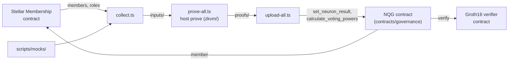

# Neuron scores proven with RISC Zero and stored on Stellar

This repository computes neuron scores for Stellar Community Fund members,
proves with [RISC Zero](https://risczero.com/) that the scores were computed
correctly, and stores them on Stellar together with the proof, in the Neural
Quorum Governance (NQG) contract that turns them into voting powers. The
private input never leaves the machine that generates the proof. Only the
scores and the proof are published.

The repository has these parts:

| Part | Path | What it does |
| --- | --- | --- |
| Prover | [`zkvm/`](zkvm) | Runs a neuron inside the RISC Zero zkVM and produces a Groth16 proof plus one output JSON file |
| Flow scripts | [`scripts/`](scripts) | `collect.ts` reads the members from chain and writes every neuron's input, `prove-all.ts` proves all neurons, `upload-all.ts` sends the proofs and calculates the voting powers |
| Submit script | [`scripts/submit-neuron.ts`](scripts/submit-neuron.ts) | Sends one output JSON, scores and proof, to the contract |
| Contract | [`contracts/governance/`](contracts/governance) | The NQG contract. Checks the proof with the Groth16 verifier, stores the scores per layer, neuron and round, and computes the voting powers |

The proof is checked on chain by the Groth16 verifier contract from
[NethermindEth/stellar-risc0-verifier](https://github.com/NethermindEth/stellar-risc0-verifier).
This repository does not contain that contract. It is deployed once per
network and the NQG contract calls it.

The NQG contract also requires every scored id to be an active member of the
Stellar Membership contract, which lives in a separate repository. The
contract's own README, [`contracts/governance/README.md`](contracts/governance/README.md),
covers its whole interface, the error codes and the link to the membership
contract.


## Contents

- [Quick start (testnet)](#quick-start-testnet)
- [How it works](#how-it-works)
- [Requirements](#requirements)
- [Set up the contracts](#set-up-the-contracts)
- [Run the full flow](#run-the-full-flow)
- [The zkVM prover](#the-zkvm-prover)
- [Build the prover](#build-the-prover)
- [Generate a proof](#generate-a-proof)
- [Submit the scores](#submit-the-scores)
- [Calculate the voting powers](#calculate-the-voting-powers)
- [Read the results](#read-the-results)
- [The contract](#the-contract)
- [What is proven and what is trusted](#what-is-proven-and-what-is-trusted)
- [After changing a neuron](#after-changing-a-neuron)


## Quick start (testnet)

One round on testnet: read the members of the Stellar Membership testnet
contract, prove the three neurons on your machine, and store the scores, the
proofs and the voting powers in an NQG contract.

You need, as described in [Requirements](#requirements): Rust with the
`wasm32v1-none` target, `r0vm` 3.0.6, Docker with 8 GiB of memory (Colima on
Apple Silicon), the Stellar CLI and Node.js 22.18 or newer. Run everything from
the repository root.

1. Build the prover, with Docker running, and install the script dependencies:

   ```sh
   cargo build --release --locked --manifest-path zkvm/Cargo.toml -p host
   npm ci --prefix scripts
   ```

2. Create and fund a testnet identity for the NQG admin:

   ```sh
   stellar keys generate admin --network testnet --fund
   ```

3. Deploy the Groth16 verifier and the NQG contract, and add the neuron layer.
   If your team already has an NQG contract on testnet and you hold its admin
   key, skip this step and set `NQG` to its id instead.

   ```sh
   git clone https://github.com/NethermindEth/stellar-risc0-verifier.git ../stellar-risc0-verifier
   git -C ../stellar-risc0-verifier checkout e8ff6ea202db195352c0141ecc533ff649393fe4
   (cd ../stellar-risc0-verifier && stellar contract build --package groth16-verifier)
   VERIFIER=$(stellar contract deploy --network testnet --source admin \
     --wasm ../stellar-risc0-verifier/target/wasm32v1-none/release/groth16_verifier.wasm)

   (cd contracts && stellar contract build)
   NQG=$(stellar contract deploy --network testnet --source admin \
     --wasm contracts/target/wasm32v1-none/release/governance.wasm \
     -- --admin admin --current_round 33 \
     --membership_contract CBIQGYBF2LPQD4W7Z3DOUUY7RBPKP3OHUOLQ6MASI7GYTBOPQPV62T7X \
     --verifier $VERIFIER)
   stellar contract invoke --network testnet --source admin --id $NQG -- add_layer \
     --raw_neurons '[["prior-voting-history",1000000],["assigned-reputation",1000000],["trust-graph",1000000]]' \
     --layer_aggregator Sum
   ```

4. Point the scripts at the contract and the admin identity:

   ```sh
   sed -e "s/<NQG governance contract id>/$NQG/" \
     -e "s/<stellar keys name of the governance admin>/admin/" \
     scripts/flow.config.example.json > scripts/flow.config.json
   ```

5. Run the round:

   ```sh
   RUN=$(node scripts/collect.ts)            # members from chain plus mocked data, into runs/r33-<time>/
   node scripts/prove-all.ts --run "$RUN"    # three Groth16 proofs, about an hour, see below
   node scripts/upload-all.ts --run "$RUN"   # three uploads, calculate_voting_powers, prints the powers
   ```

The last command ends with every active member's voting power, for example:

```
Voting powers, round 33:
       1  10.183423
       2  7.938100
       3  4.370918
       ...
```

Proving the 13 testnet members takes about an hour on an Apple Silicon Mac,
most of it the trust graph. Only the members and their roles come from chain;
Discord roles, the trust graph and the voting history are synthetic data from
[`scripts/mocks/`](scripts/mocks), see [Mocked data](#mocked-data). The
sections [Set up the contracts](#set-up-the-contracts) and
[Run the full flow](#run-the-full-flow) explain each step.


## How it works



1. `collect.ts` asks the NQG contract for its active round and for the
   membership contract it validates against, reads the active members and
   their roles from that contract, and writes one private input file per
   neuron, with the mocked data for what is not on chain yet.
2. `prove-all.ts` runs `host prove` for each neuron. The zkVM runs the neuron
   as a guest program on the private input. The guest calculates the scores
   and commits the round and the scores as its public output, the journal. The
   prover wraps the run in a Groth16 proof and writes one output JSON file.
3. `upload-all.ts` scales every score to an integer with 6 decimal places and
   calls `set_neuron_result` on the NQG contract for each neuron.
4. The contract checks that the caller is the admin and that every scored id
   is an active member, hashes the journal, and asks the Groth16 verifier
   whether the proof matches the journal and the neuron's Image ID. Only when
   all checks pass does it store the scores and the proof under that layer,
   neuron and round. A failed check stores nothing.
5. `upload-all.ts` then calls `calculate_voting_powers`, and the contract
   weighs and adds up the scores into each member's voting power.

The private input stays on the machine that proves. To prove or submit a
single neuron by hand, see [Generate a proof](#generate-a-proof) and
[Submit the scores](#submit-the-scores).


## Requirements

For proving:

- [Rust](https://rustup.rs/). `zkvm/` uses the stable toolchain from
  [`zkvm/rust-toolchain.toml`](zkvm/rust-toolchain.toml).
- [`rzup`](https://github.com/risc0/risc0/blob/main/risc0/cargo-risczero/README.md)
  and `r0vm` 3.0.6. The host calls this binary to prove locally. No remote
  prover is used.

  ```sh
  curl -L https://risczero.com/install | bash
  rzup install r0vm 3.0.6
  rzup use r0vm 3.0.6
  ```

- Docker with BuildKit support. Choose the path for your setup:

  **Path 1: You already have Docker Desktop**

  Start Docker Desktop. It includes Buildx and BuildKit, so no separate
  Docker or Buildx installation is needed. Continue to the verification
  commands below.

  **Path 2: You do not have Docker Desktop (Apple Silicon Mac)**

  Install Colima, the Docker CLI and Buildx with
  [Homebrew](https://formulae.brew.sh/formula/docker-buildx):

  ```sh
  brew install colima docker docker-buildx
  mkdir -p "$HOME/.docker/cli-plugins"
  ln -sfn "$(brew --prefix)/opt/docker-buildx/bin/docker-buildx" \
    "$HOME/.docker/cli-plugins/docker-buildx"
  ```

  If you already use Colima, install only missing packages. The symlink
  makes the Homebrew plugin discoverable by Docker, as described in the
  [Colima setup instructions](https://github.com/abiosoft/colima/blob/main/docs/FAQ.md#docker-buildx-plugin-is-missing).

  Give the virtual machine 8 GiB of memory; with the default 2 GiB the
  Groth16 container is killed. Enable Rosetta because the guest builder
  exists only for `linux/amd64`, and QEMU emulation is much slower:

  ```sh
  colima start --vm-type vz --vz-rosetta --memory 8 --cpu 4
  ```

  If Colima is already running, run `colima stop` before applying these
  settings. Later `colima start` calls keep them. If the existing virtual
  machine uses QEMU and refuses these settings, recreate it with
  `colima delete` and run the start command again. This deletes the images
  and containers stored in Colima.

  **Verify either path**

  After starting Docker Desktop or Colima, verify the plugin and the
  connection to Docker:

  ```sh
  docker buildx version
  docker info
  ```

  Docker is used twice. Building the prover compiles the guests in
  `risczero/risc0-guest-builder:r0.1.91.1`, pinned by SHA-256 digest in
  [`zkvm/methods/build.rs`](zkvm/methods/build.rs). Proving runs
  `risczero/risc0-groth16-prover:v2025-04-03.1`, which `r0vm` starts to turn
  the proof into Groth16.

For the contracts, collecting and submitting:

- [Stellar CLI](https://developers.stellar.org/docs/tools/developer-tools/cli/install-cli).
  It loads a `.env` from the current folder or any parent, and a
  `STELLAR_RPC_URL` or `STELLAR_NETWORK_PASSPHRASE` there overrides
  `--network`. `stellar env` shows what it picked up. The flow scripts are not
  affected: they pass the network from their config.
- The `wasm32v1-none` Rust target, to build the contracts:

  ```sh
  rustup target add wasm32v1-none
  ```

- Node.js 22.18 or newer. The scripts are TypeScript that Node runs directly,
  without a build step. `collect.ts` reads ledger entries with
  `@stellar/stellar-sdk`, so install the dependencies once:

  ```sh
  npm ci --prefix scripts
  ```


## Set up the contracts

Once per network. The NQG contract needs the address of a Groth16 verifier
and of the Stellar Membership contract at deploy time. The commands use
testnet and a Stellar CLI identity named `admin`, which becomes the NQG admin:
only it can upload scores and calculate voting powers.

1. The verifier. Build `groth16-verifier` from
   [NethermindEth/stellar-risc0-verifier](https://github.com/NethermindEth/stellar-risc0-verifier)
   and deploy it. It takes no constructor arguments. Nethermind publishes no
   deployment, so each network needs its own. Commit `e8ff6ea` is the one
   tested with this prover; a verifier for another RISC Zero version can
   reject its proofs.

   ```sh
   git clone https://github.com/NethermindEth/stellar-risc0-verifier.git ../stellar-risc0-verifier
   git -C ../stellar-risc0-verifier checkout e8ff6ea202db195352c0141ecc533ff649393fe4
   (cd ../stellar-risc0-verifier && stellar contract build --package groth16-verifier)
   VERIFIER=$(stellar contract deploy --network testnet --source admin \
     --wasm ../stellar-risc0-verifier/target/wasm32v1-none/release/groth16_verifier.wasm)
   ```

2. The NQG contract, built from this repository. `--current_round` is the
   round being scored, at least 8 for prior voting history.
   `--membership_contract` is the Stellar Membership deployment; on testnet
   `CBIQGYBF2LPQD4W7Z3DOUUY7RBPKP3OHUOLQ6MASI7GYTBOPQPV62T7X`, recorded in
   `contracts/deployments/stellar-membership-testnet` of the membership
   repository.

   ```sh
   (cd contracts && stellar contract build)
   NQG=$(stellar contract deploy --network testnet --source admin \
     --wasm contracts/target/wasm32v1-none/release/governance.wasm \
     -- --admin admin --current_round 33 \
     --membership_contract CBIQGYBF2LPQD4W7Z3DOUUY7RBPKP3OHUOLQ6MASI7GYTBOPQPV62T7X \
     --verifier $VERIFIER)
   ```

3. One layer with the three neurons, each with weight 1.0, summed:

   ```sh
   stellar contract invoke --network testnet --source admin --id $NQG -- add_layer \
     --raw_neurons '[["prior-voting-history",1000000],["assigned-reputation",1000000],["trust-graph",1000000]]' \
     --layer_aggregator Sum
   ```

   On a new contract the layer gets id `0` and the neurons ids `0`, `1` and
   `2`, in this order. Name the neurons exactly like this: `upload-all.ts`
   refuses to send a neuron's scores to a neuron with another name.

For the next round, `set_current_round --round <round>` moves the contract on.
Results of earlier rounds stay stored.


## Run the full flow

Three scripts run one round end to end. They hand over through a run folder,
`runs/r<round>-<time>/`, which is in `.gitignore` because it holds the private
input:

| Step | Script | Reads | Writes to the run folder |
| --- | --- | --- | --- |
| 1 | `collect.ts` | the NQG contract (active round, membership address), the membership contract (members), [`scripts/mocks/`](scripts/mocks) | `snapshot.json`, `inputs/<neuron>.json` |
| 2 | `prove-all.ts` | `inputs/` | `proofs/<neuron>.json` |
| 3 | `upload-all.ts` | `proofs/` | `submitted.json`; on chain the three results and the voting powers |

Requirements: the prover built and Docker running (see
[Build the prover](#build-the-prover)), the contracts set up as above, and
the script dependencies installed.

### Configure

```sh
cp scripts/flow.config.example.json scripts/flow.config.json
```

Then set `governance` and `source`. The example points at testnet.

| Field | What it is |
| --- | --- |
| `rpcUrl`, `networkPassphrase` | The network. Every script passes both to the Stellar CLI, so a `STELLAR_RPC_URL` in `.env` cannot redirect them |
| `governance` | The NQG contract id |
| `source` | Stellar CLI identity of the NQG admin. It pays for the reads and signs the uploads |
| `neurons` | Layer and neuron id of each neuron in the NQG contract |

`scripts/flow.config.json` is in `.gitignore`. Every script takes
`--config <path>` to use another file.

### 1. Collect

```sh
RUN=$(node scripts/collect.ts)
```

The script asks the NQG contract for its active round and for the membership
contract it validates against, reads every minted token from that membership
contract, and keeps the active ones. Their ids are the users of all three
neurons, since `calculate_voting_powers` needs every neuron to score the same
members. It then builds each neuron's input from the members and the mocked
data, and prints the run folder. `--out <dir>` picks the folder.

### 2. Prove

```sh
node scripts/prove-all.ts --run "$RUN"
```

Before proving, the script compares the prover's Image IDs with the constants
in [`contracts/governance/src/verifier.rs`](contracts/governance/src/verifier.rs)
and stops if they differ, because the contract would reject the proofs. It
then runs `host prove --round <round>` for each neuron, one after another, and
checks that every proof is for the run's round and scores exactly the run's
users with finite numbers. A neuron that already has a proof is skipped, so
after a failure the same command continues. `RISC0_WORK_DIR` defaults to
`~/.risc0/groth16-work`.

The Groth16 step needs nearly all of Docker's 8 GiB. Stop other containers
while proving: when memory runs out, the Groth16 container is killed and
Docker returns exit code 137.

Proving time grows with the number of members, the trust graph fastest: its
PageRank runs 1000 iterations over every pair of member and trust list. For
the 13 testnet members, on an Apple Silicon Mac with Colima (4 CPUs, 8 GiB),
prior voting history took 6 minutes, assigned reputation under 1 and the trust
graph 48.

### 3. Upload

```sh
node scripts/upload-all.ts --run "$RUN"
```

Nothing is sent until these simulated checks pass: the contract's active
round is the run's round, it still validates against the membership contract
the run read, every neuron in the contract is in the config, and each neuron
has the expected name. The script then calls `set_neuron_result` for the three
neurons, `calculate_voting_powers`, and prints the voting powers. Each step is
recorded in `submitted.json`. Running it again sends everything again, which
replaces the stored results.

### Mocked data

Only the members and their roles are on chain today. The rest comes from
synthetic files in [`scripts/mocks/`](scripts/mocks), keyed by membership
token id:

| File | Becomes | Later from |
| --- | --- | --- |
| `discord-roles.json` | `discord_roles` of assigned reputation | Discord roles of the account the member bound |
| `trust-graph.json` | `trustedForUser` of the trust graph | wherever members declare trust |
| `prior-voting-history.json` | `usersRoundHistory`, `votesPerRound`, `submittersPerRound` | the voting records |

Ids that are not active members are dropped, as truster, trusted id, voter or
submitter, and the script lists them. Active members missing from a file get
nothing: no roles, no trust, no history. The trust graph needs at least one
trust between active members, since the guest fails on an empty graph.

When a source moves on chain, only its reader in `collect.ts` changes. The
input files and the other two scripts stay as they are.


## The zkVM prover

The current prover supports three neurons:

| `--neuron` | Private input | Scoring logic | Example input |
| --- | --- | --- | --- |
| `prior-voting-history` | `users`, `usersRoundHistory`, `votesPerRound`, `submittersPerRound` | Voting-history and active-participation bonuses | [`example_prior_voting_history.json`](zkvm/data/example_prior_voting_history.json) |
| `assigned-reputation` | `users`, each with `id`, `tier`, `discord_roles` | Reputation-tier bonus plus Discord-role bonuses | [`example_assigned_reputation.json`](zkvm/data/example_assigned_reputation.json) |
| `trust-graph` | `users`, `trustedForUser` | Normalized PageRank with bonuses for trust from highly trusted users and filled trust lists | [`example_trust_graph.json`](zkvm/data/example_trust_graph.json) |

The implementation is split into:

- [`zkvm/core/`](zkvm/core): shared input types, validation and scoring logic.
- [`zkvm/methods/`](zkvm/methods): one guest program per neuron. Each reads the
  round and private input, calculates scores, and commits the output journal.
  The build embeds each compiled guest and its Image ID into the host.
- [`zkvm/host/`](zkvm/host): reads the input JSON and the round (`--round`
  or `.env`), calls local `r0vm` with Groth16 proving enabled and development
  mode disabled, then decodes the journal and writes the submission file.


## Build the prover

Start Docker first: the build compiles the guests inside the guest builder
image and fails if Docker is not running.

```sh
cargo build --release --locked --manifest-path zkvm/Cargo.toml -p host
```

The first build downloads the guest builder image and might take
several minutes. Later builds reuse Docker's cache.

The binary is `zkvm/target/release/host`. It has two commands:

| Command | What it does |
| --- | --- |
| `host image-id --neuron <neuron>` | Prints the Image ID of the guest compiled into this binary |
| `host prove --neuron <neuron> --input <json> --output <json> [--round <round>]` | Generates a proof |

`<neuron>` is `prior-voting-history`, `assigned-reputation` or `trust-graph`.
If `--neuron` is left out, `prior-voting-history` is used, so always pass it.

Print the three Image IDs to compare them with the guest IDs expected by
the existing NQG contract:

```sh
zkvm/target/release/host image-id --neuron prior-voting-history
zkvm/target/release/host image-id --neuron assigned-reputation
zkvm/target/release/host image-id --neuron trust-graph
```

Because the guests are compiled in a pinned Docker image, the same commit gives
the same Image IDs on every machine and in every folder. Anyone can check the
Image IDs in the contract by building that commit and running these commands.


## Generate a proof

### 1. Set the round

The round is not part of the input file. Pass it with `--round 33`, or put it
in a `.env` file in the working directory or one of its parents, which
`host prove` reads when `--round` is missing. A shell variable named
`CURRENT_ROUND` is ignored.

```sh
echo "CURRENT_ROUND=33" > .env
```

This replaces the whole file. If `.env` holds other settings, edit the
`CURRENT_ROUND` line instead. `.env` is in `.gitignore`.

### 2. Point RISC Zero at a work directory Docker can see

On macOS the default work directory is under `/var/folders`, which Colima does
not mount, so the Groth16 container would see no files. Run this in the same
terminal as `host prove` (`prove-all.ts` sets it itself):

```sh
mkdir -p "$HOME/.risc0/groth16-work"
export RISC0_WORK_DIR="$HOME/.risc0/groth16-work"
```

### 3. Prove

Docker must be running. Create the output directory once:

```sh
mkdir -p zkvm/artifacts
```

Assigned reputation, the faster example:

```sh
zkvm/target/release/host prove --neuron assigned-reputation \
  --input zkvm/data/example_assigned_reputation.json \
  --output zkvm/artifacts/assigned-reputation-33.json
```

Prior voting history:

```sh
zkvm/target/release/host prove --neuron prior-voting-history \
  --input zkvm/data/example_prior_voting_history.json \
  --output zkvm/artifacts/prior-voting-history-33.json
```

Trust graph:

```sh
zkvm/target/release/host prove --neuron trust-graph \
  --input zkvm/data/example_trust_graph.json \
  --output zkvm/artifacts/trust-graph-33.json
```

The files in `zkvm/data/` are synthetic, and their ids are not members of the
testnet membership contract, so the contract would refuse their scores with
`NotAMember`. To prove something you can submit, use an input written by
`collect.ts`, `"$RUN"/inputs/<neuron>.json`. Proving takes several minutes.

`host prove` never overwrites files. Each run needs a new `--output` path, and
its parent directory must exist. The path is checked after proving, so pick a
new name before you start. Putting the round in the
file name is a simple way to keep them apart.

### The output file

`--output` holds everything needed on chain, from a single run:

```json
{
  "currentRound": 33,
  "scores": {
    "0": 1.5,
    "1": 2.25
  },
  "journal": "<hex>",
  "seal": "<hex>",
  "imageId": "<64 hex characters>"
}
```

| Field | What it is |
| --- | --- |
| `currentRound` | The round from `--round` or `.env`, as proven in the journal |
| `scores` | Person (membership token) id to score, decoded from the journal |
| `journal` | Raw journal bytes, hex |
| `seal` | Groth16 proof with the 4-byte selector, hex |
| `imageId` | Image ID of the guest that produced the proof |

Keep the `--output` file. It is what you submit, and it is the only copy of
the proof.


## Submit the scores

`upload-all.ts` submits all three neurons of a run. To submit one output file
by hand, you need the NQG contract id, the layer and neuron ids of the neuron
(`0` to `2` with the setup above) and a proof for the contract's active round.
Build the prover from the commit matching the contract's guest Image IDs;
otherwise the contract rejects the proof.

The Stellar CLI must have the admin identity used as `--source`, and that
account must exist on the selected network. The script requires its
authorization and submits a transaction that pays a fee. Layer `0`, neuron
`1` is assigned reputation in the setup above:

```sh
node scripts/submit-neuron.ts \
  --neuron assigned-reputation \
  --output "$RUN/proofs/assigned-reputation.json" \
  --layer-id 0 \
  --neuron-id 1 \
  --contract "$NQG" \
  --source admin \
  --network testnet
```

All seven flags are required and unknown flags are rejected. `--neuron` must
match the neuron that produced the output file, as in `host prove`; with the
wrong neuron, the verifier rejects the proof because the Image ID differs.


The script:

1. Reads `currentRound`, `scores`, `journal`, `seal` and `imageId` from the
   output file.
2. Checks that every id is a decimal `u32` and every score a finite number.
3. Converts each score to text and scales it to an integer with 6 decimal places.
4. Asks the contract for its active round and stops if it is not
   `currentRound`. The contract stores the scores under its active round, not
   under the round in the file.
5. Asks the contract for the neuron and stops if it does not exist. The
   contract would otherwise store the scores under any layer and neuron id.
6. Prints the neuron's name and runs:

   ```sh
   stellar contract invoke --id <NQG> --source <SOURCE> --network <NETWORK> \
     -- set_neuron_result \
     --layer_id 0 \
     --neuron_id 1 \
     --result '{"0":1500000,"1":2250000}' \
     --guest AssignedReputation \
     --journal <JOURNAL_HEX> \
     --seal <SEAL_HEX>
   ```

Steps 4 and 5 are simulations and cost no fee. The Stellar CLI output is shown
as is. A non-zero exit code means the script stopped or the call failed, and
nothing was stored. The contract refuses the call with `NotAMember` (error 18)
when an id is not an active member, and with `InvalidProof` (error 20) when the
verifier does not accept the proof.

Submitting again for the same layer, neuron and round replaces the stored
scores and proof. Results for other rounds stay unchanged.


## Calculate the voting powers

`upload-all.ts` does this after its uploads. By hand: when every neuron of
every layer has scores for the active round, the admin calculates the voting
powers:

```sh
stellar contract invoke --network testnet --source admin --id "$NQG" \
  -- calculate_voting_powers
```

All layers must cover the same members, otherwise the call fails with
`LayerResultsUsersMismatch` (error 17). A neuron without scores for the round
fails it with `NeuronResultNotSet` (error 7). After replacing any scores,
calculate again.


## Read the results

Anyone can read the stored data. `--send=no` simulates the call and does not
create a transaction or cost a fee. The CLI still needs a `--source` account
that exists on the network, but it can be any account, not only `admin`.

```sh
stellar contract invoke --send=no --network testnet --source admin \
  --id "$NQG" \
  -- \
  get_voting_powers
```

This returns the map from member id to voting power for the active round,
with 6 decimals, for example `{"1":10183423,"2":7938100,"3":4370918,...}`.
`get_voting_power_for_user --member_id 1` returns one member's.

```sh
stellar contract invoke --send=no --network testnet --source admin \
  --id "$NQG" \
  -- \
  get_neuron_result --layer_id 0 --neuron_id 1
```

This returns one neuron's scores for the active round, for example
`{"1":4000000,"2":4500000,"3":3000000,...}`. Divide by 10^6 for the original
value.

```sh
stellar contract invoke --send=no --network testnet --source admin \
  --id "$NQG" \
  -- \
  get_neuron_proof --layer_id 0 --neuron_id 1
```

This returns the `seal`, `image_id`, and `journal_digest` that were checked.
For an earlier round use `get_neuron_result_round` and `get_neuron_proof_round`
with `--round`. They return `NeuronResultNotSet` (error 7) and
`NeuronProofNotSet` (error 21) when nothing is stored for that neuron and
round.


## The contract

The NQG contract is a Soroban contract in the [`contracts/`](contracts) Cargo
workspace, using `soroban-sdk` 28. Its
[README](contracts/governance/README.md) lists every function and error code.
The proof check is in
[`contracts/governance/src/verifier.rs`](contracts/governance/src/verifier.rs).

`set_neuron_result(layer_id, neuron_id, result, guest, journal, seal)` step by
step:

1. Requires the admin's signature.
2. Calls `member(id)` on the membership contract for every id in `result` and
   requires each one to be active.
3. Takes the Image ID constant of `guest`: `PriorVotingHistory`,
   `AssignedReputation` or `TrustGraph`.
4. Computes `journal_digest = sha256(journal)`.
5. Calls `verify(seal, image_id, journal_digest)` on the verifier. If the
   verifier rejects the proof or cannot answer, the call fails with
   `InvalidProof`.
6. Stores `result`, and `NeuronProof { seal, image_id, journal_digest }` next
   to it, under the layer, the neuron and the active round.

The contract stores only the journal's digest, which is what `verify` needs.
The full journal is still an argument, so the contract computes the digest
itself and the caller cannot pass a digest that does not belong to the journal.
The journal therefore stays readable in the `set_neuron_result` transaction in
Stellar's transaction history, but not in contract storage, so other contracts
cannot read it.

The tests use a mock verifier, so they check what the contract sends to it,
not a real Groth16 proof. Run them in `contracts/`:

```sh
cd contracts
stellar contract build
cargo test --all-features
```

`stellar contract build` comes first because one test upgrades the contract to
a mock WASM.


## What is proven and what is trusted

A valid proof shows that the guest with this Image ID ran correctly and that
the journal, the round and the scores, is its output. The contract stores
nothing unless such a proof exists for the submitted journal.

What is not proven:

- **The input.** The proof does not show that the voting history, roles, or
  tiers are real or complete, or who supplied them. The input provider is
  trusted.
- **The round.** The proof shows which round the scores were calculated for,
  not that it is the actual current round. The contract does not compare the
  round in the journal with its active round; the scripts do.
- **That the stored scores are the journal's.** The contract does not decode
  the journal. It stores `result` as sent, and the scripts send the scores
  that `host prove` decoded from the journal. The admin is trusted to
  send matching scores, and anyone can check them: the journal is in the
  `set_neuron_result` transaction, and its digest is stored with the proof.
- **The layer and neuron.** The contract does not tie a guest to a layer or
  neuron. The admin chooses both.

Privacy: the journal contains only the round and the scores. It contains no
votes, participation history, author lists, roles, or tiers, and no commitment
to the input. The scores themselves still reveal something about each
member's activity.

## After changing a neuron

Changes to a guest in `zkvm/methods/` or to a core crate in `zkvm/core/`
can change the Image ID, even removing a comment line, because panic messages
in the binary can contain line numbers. A dependency update or a change to
the pinned Docker builder can change it too.

Rebuild the prover and run `host image-id` for all three neurons, or let
`prove-all.ts` do it. Compare the IDs with the constants in
[`contracts/governance/src/verifier.rs`](contracts/governance/src/verifier.rs).
If an ID changes, the contract administrator must update the accepted guest
ID before proofs from the new build can be submitted. Until then, use the
prover built from the commit matching the existing contract.
